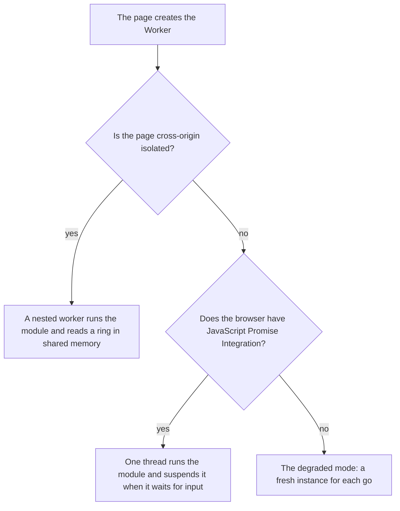

# UCI over WASI

UCI over WASI is a way to ship a chess engine as one WebAssembly file. The file runs unchanged in a
browser, under a JavaScript runtime, and under any other host that follows this document.

The engine speaks UCI on standard input and standard output, as a native engine does. The file is a WASI
preview-1 command, so it needs no glue code of its own.

This document began as the Ratchet chess engine's reading of how UCI and WASI fit together. No standard exists in the field. Other
engines and other hosts may adopt it.

- **Part 1** is for an engine's author: what a module must do, and what it may rely on.
- **Part 2** is for a host's author: what a host must answer and deliver.
- **Part 3** describes the reference host, which is in this repo. It is a record of one implementation, not a rule.

`helper/README.md` is the how-to for adapting an existing engine.

## Terms

| term | meaning |
|---|---|
| **module** | the engine as one WebAssembly file that meets Part 1; this repo's `AGENTS.md` calls it a WASI build |
| **host** | the program that runs a module: it answers the module's imports, feeds its input and takes its output |
| **GUI** | whatever writes the UCI lines, as in UCI: a chess GUI, a match runner, a page, a person at a terminal |
| **profile** | how an engine takes input during a search: **polls** or **deaf** |
| **polls** | the module hears its input during a search, from inside its search or on an input thread of its own, so it hears `stop` |
| **deaf** | the module reads nothing during a search, so a line takes effect when the search ends |
| **unbounded** | said of a `go` that nothing ends but a `stop` (§ The unbounded `go`) |
| **poll helper** | the file in `helper/` that puts a thread engine's search on the UCI thread |
| **thread engine** | an engine whose search runs apart from its UCI loop: on a thread, with an input thread and a stop flag, or in a goroutine |

## Part 1: the module

### Form

- The module is a WASI preview-1 command. It exports `_start` and `memory`.
- It imports only from `wasi_snapshot_preview1`. A module with threads also has wasi-threads' two imports
  (§ Threads).
- It starts a thread only through wasi-threads.
- It is a 32-bit module, so it addresses at most 4 GiB.
- It may use every feature of WebAssembly 2.0, fixed-width SIMD with its 128-bit vectors among them. Every
  host has them (§ Running a module).
- Beyond those, it may use the features that § The declaration names, and it declares each one it uses.
- It uses a relaxed SIMD operation only where the operation's result is fixed by its inputs. An example is
  `i32x4.relaxed_dot_i8x16_i7x16_add_s` with every byte of its second operand in [0, 127]. Any other use
  can give different results on different CPUs, so two runs of a module would not be the same run.
- The proof that its relaxed operations are exact is its node signature: the same total of nodes over the
  same searches, on an x86 CPU and on an ARM CPU. A checker can list a module's relaxed operations, but it
  cannot read their operands' range from the module.

The host calls `_start` once. The module's whole session runs inside that call.

### Input and output

| stream | carries |
|---|---|
| fd 0, standard input | the GUI's UCI lines, each ended by a line feed |
| fd 1, standard output | the module's UCI lines, each ended by a line feed |
| fd 2, standard error | diagnostics, which no GUI reads |

- The module writes each line in full before it waits for input. A line left in a buffer never reaches the GUI.
- The module accepts a carriage return before a line feed, and ignores it. A GUI on Windows may send one.
- The command line is the module's own. The first argument is the module's name. A host passes the rest
  unchanged, so an argument such as `bench` works as it does natively.

### What a module may rely on

A module may rely on seven calls. § The seven calls states what each one answers.

| call | use |
|---|---|
| `args_sizes_get`, `args_get` | the command line |
| `clock_time_get` | the time, for the engine's clock |
| `fd_read` | input from fd 0; it waits until input arrives or ends |
| `fd_write` | output to fd 1 and fd 2 |
| `poll_oneoff` | whether input waits on fd 0, and a sleep |
| `proc_exit` | the end of the module, with an exit code |

A C library, a Rust standard library or a Go runtime imports more of preview 1 than these seven. A host gives
each other import a fixed answer (§ The fixed answers). A module that needs more than those answers does not
meet this document. In practice:

- **No file system.** A module opens no file.
  - **A net** is compiled into the module.
  - **The openings are the GUI's.** The GUI chooses a book and sends positions, so an engine's own book is off.
  - **Tablebases are the GUI's too,** to adjudicate a game. An engine's own probing of tablebases is off.
- **No environment.** There are no environment variables.
- **Repeatable random bytes.** `random_get` fills from a fixed seed, so two runs of a module are the same run.

### Hearing input during a search

A module with the polls profile checks its input from inside its search. The engine's own periodic check
does this, the one that reads the clock every so many nodes.

1. Call `poll_oneoff` with two subscriptions: a read of fd 0, and a clock with a relative timeout of zero.
   The clock makes the call return at once.
2. If the event says fd 0 is ready, call `fd_read` and act on the lines.

To wait without spinning, call `poll_oneoff` with the read of fd 0 alone, or call `fd_read`. Both wait
until input arrives or ends.

A host answers a read of fd 0 and clocks with relative timeouts. It answers no other subscription.

### What a module does with each line

These rules apply while a search runs. Between searches a module handles lines as UCI states.

| line | rule |
|---|---|
| `uci` | A module may expect `uci` as the first line of every session, as UCI states. |
| `stop` | The search ends and prints its `bestmove`. |
| `ponderhit` | The ponder search goes on as a normal search. |
| `isready` | The module answers `readyok` at once, but only when no earlier line still waits to be handled. |
| `quit` | The module exits as soon as possible. Whether it first prints a `bestmove` is the engine's own choice. |
| any other line | The module keeps the line, in order, and handles it after the search. |

The `isready` rule protects the GUI. A GUI reads `readyok` as proof that every earlier line was handled.
So an `isready` that arrives behind a queued `position` waits its turn.

### The end of input

The end of input means that no more input comes. It does not mean `quit`.

- A bounded search finishes and prints its `bestmove`.
- An unbounded search ends as on `stop` and prints its `bestmove`.
- Then the module exits with code 0.

Every `go` gets a `bestmove`. So a script that pipes its commands needs no pause, and a module never
hangs at the end of input. A bench from the command line runs to its end whether input is open or ended.

### The unbounded `go`

A `go` is unbounded when nothing in it ends the search. Only a `stop` ends it.

A module decides this in its own terms. A limit the engine does not act on is no bound for that engine.

- `go infinite` is unbounded.
- A ponder search is unbounded until its `ponderhit`.
- A `go` with no limit the engine acts on is unbounded. A bare `go` is always one of these.

The third case matters at the end of input. An engine alone would search such a `go` to its depth limit.

### The declaration

A module declares itself in a custom section named `uci_over_wasi`. The section holds lines of `key=value`,
and each line ends with a line feed.

| key | value | with no such line |
|---|---|---|
| `profile` | the module's profile: `polls` or `deaf` (§ The profile) | polls |
| `requires` | the features beyond WebAssembly 2.0 that the module uses, separated by spaces | none |

No other key exists yet. `requires` names each feature by its WebAssembly proposal's name:

| feature | the module uses |
|---|---|
| `threads` | a thread at every `Threads` setting, `Threads` 1 included, so it cannot run where a host starts no thread (§ Threads) |
| `relaxed-simd` | a relaxed SIMD operation, in the exact form § Form allows |
| `exception-handling` | WebAssembly exception handling, as C's `setjmp` and `longjmp` and C++ exceptions build to |

A module declares every feature it uses, and no feature it does not use. A module that starts threads only
above `Threads` 1 is the one exception: it does not declare `threads`, because it runs without them. A host
without a declared feature refuses the module, and says which feature it lacks. One module serves every host: an engine ships no second
file without the feature.

`llvm-objcopy --add-section=uci_over_wasi=<file>` writes the section into a linked module, with no change to
the source:

```sh
printf 'profile=deaf\nrequires=exception-handling\n' > declaration.txt
llvm-objcopy --add-section=uci_over_wasi=declaration.txt engine.wasm
```

### The profile

An engine fits one of two profiles, and its module declares it.

| profile | the engine | as a module |
|---|---|---|
| **polls** | hears input during a search: from inside its search, or on an input thread of its own | runs as it is |
| **deaf** | reads nothing during a search | runs as it is, and its host keeps from it what it could not act on |

- `profile=deaf` declares a deaf module. A deaf module needs the line: its host must keep `stop` and an
  unbounded `go` away from it.
- `profile=polls`, no `profile` line, or no section declares a polls module.

A thread engine is a polls module in one of two forms. Through the poll helper, its search runs on the UCI
thread and polls. With threads, its input thread hears the line (§ Threads). Go has no threads in a module, so
a Go engine takes the poll helper.

### Threads

A module may search on several threads, through wasi-threads, the thread proposal of preview 1.

- It imports `thread-spawn` from module `wasi`, of type `(i32) -> i32`.
- It imports its memory as `env.memory`: shared, and with a maximum. It also exports it as `memory`.
- It exports `wasi_thread_start`, of type `(i32, i32) -> ()`.
- A trap or a `proc_exit` on any thread ends the whole module.
- It reads fd 0 from one thread at a time. A host's input is one stream.

wasi-libc's `pthread_create` builds on these, in wasi-sdk's `wasm32-wasip1-threads` target. A spawn that the
host cannot start returns a negative value, and `pthread_create` then returns `EAGAIN`.

A module takes one of two forms.

| form | at `Threads` 1 | declares | runs |
|---|---|---|---|
| threads above `Threads` 1 only | starts no thread | nothing for threads | on every host that follows this document; where a host starts no thread, on the threads it has |
| a thread at every setting | starts a thread for its search or its input | `requires=threads` | only where a host starts threads; in a browser, on a cross-origin isolated page |

- **The first form is the one to choose.** It runs on every page. A plain preview-1 host that gives no shared
  memory still refuses it, because it cannot answer the memory import. An engine reaches it through the poll
  helper, with its search's other threads started only above `Threads` 1.
- **The second form keeps a thread engine as it is.** Its UCI loop must still meet § What a module does with
  each line and § The end of input. A native thread engine often answers an `isready` ahead of a line queued
  before it, or ends a timed search at the end of input.
- **A search on several threads does not repeat.** A node signature is read at `Threads` 1.

The memory's maximum is fixed when the module is linked (wasm-ld's `--max-memory`). Without one, a shared
memory never grows past its initial size.

- **Some platforms reserve the whole maximum up front.** iOS Safari has refused shared memories of 2 and
  4 GiB.
- **One module serves every device,** so the maximum is one trade-off. A large one gives `Hash` room, and a
  small one runs on more phones. The engine chooses it, and `Hash`'s maximum fits inside it.

### UCI options

- **`Threads`** defaults to 1, if the engine has the option. Its maximum is 1 for a module without threads.
- **`Hash`** has a maximum the module can allocate. The adapted engines in `adapted/` cap it at 1024 MB. A table size wraps at
  4096 MB in a 32-bit module, and an allocation can fail well below that.

## Part 2: the host

### Running a module

- The host's runtime has every feature of WebAssembly 2.0, fixed-width SIMD among them.
- The host refuses a module that imports from anywhere but `wasi_snapshot_preview1`, except wasi-threads'
  two imports (§ Starting threads).
- It reads the module's declaration (§ Reading the declaration) before it runs the module.
- It refuses a module that requires a feature it lacks, with a message that names the feature.
- It calls `_start` once, with the command line the GUI gave.
- The module ends when `_start` returns, with code 0, or when it calls `proc_exit`.

### The seven calls

| call | the host answers |
|---|---|
| `args_sizes_get`, `args_get` | the command line, the module's name first |
| `clock_time_get` | clock 0: the time of day. Every other clock: a monotonic clock. Both in nanoseconds. |
| `fd_read` | on fd 0, at least one byte once input waits, or zero bytes at the end of input; it waits for either. On any other fd, `EBADF`. |
| `fd_write` | on fd 1 and fd 2, every byte, in order. On any other fd, `EBADF`. |
| `poll_oneoff` | one event: fd 0 if it has input or has ended, else the soonest clock once its timeout passes |
| `proc_exit` | the end of the module, with that exit code |

For `poll_oneoff`:

- A read of fd 0 is ready when input waits or has ended. Its event says how many bytes wait, and sets the
  hang-up flag at the end of input.
- A clock's timeout is relative. A timeout of zero makes the call return at once.
- A call with a read alone waits until input arrives or ends.
- Any other subscription gets `EINVAL`.

### The fixed answers

A host answers every other preview-1 import the same way each time.

| call | the host answers |
|---|---|
| `fd_fdstat_get` on fd 0, 1, 2 | a character device with every right |
| `fd_fdstat_get` on any other fd | `EBADF` |
| `fd_prestat_get` | `EBADF`: there are no preopened directories |
| `fd_seek` | `ESPIPE` |
| `environ_sizes_get`, `environ_get` | an empty environment |
| `random_get` | bytes from a fixed seed |
| `sched_yield` | success: the runtime schedules the threads |
| every other call | `ENOSYS` |

### Starting threads

A host answers a wasi-threads module's two imports.

| import | the host answers |
|---|---|
| `env.memory` | a shared memory with the import's initial size and maximum; every thread of the module gets the same one |
| `wasi.thread-spawn(arg)` | starts a thread that instantiates the same module with the same memory and the same answers, and calls its `wasi_thread_start(id, arg)`; returns `id`, unique and in [1, 2^29) |

- **A trap or a `proc_exit` on any thread ends the module,** and every thread. The exit code is the
  `proc_exit`'s, or 1 for a trap.
- **Every thread reads the same monotonic clock.**
- **`thread-spawn` returns the id at once,** without waiting for the thread to start. The thread that called
  it runs on inside the module, and may not yield until its search ends.
- **A host that cannot start a thread where it runs** still gives the memory, and answers `thread-spawn` with a
  negative value. It refuses a module that requires threads. A page that is not cross-origin isolated is such
  a place, because its memory cannot reach a second Worker.

### Delivering input during a search

A host delivers input to a running search. A `stop` that the GUI writes reaches a polls module's next
poll. This is the host's main duty, and how the host does it is the host's own business.

A search does not return to the host until it ends. So the host needs a way to make input appear to code
that is already running. Three ways are known.

| way | how | needs |
|---|---|---|
| a second thread | Another thread receives the input and writes it into memory both threads share. The module's thread reads it there. | shared memory; in a browser, a cross-origin isolated page |
| suspending the module | `fd_read` and `poll_oneoff` suspend the module, and the host's event loop takes the input. | a runtime with JavaScript Promise Integration |
| rewriting the module | A tool rewrites the linked module so that the host can unwind and rewind its stack (Asyncify). | a second file per module |

The first two need no change to a module. The reference host uses them (Part 3). The third is not built.

A host that suspends the module need not suspend at every poll. It gives its event loop a turn every few
milliseconds, and answers the other polls at once.

### A host that cannot deliver

This document gives no rule for a host with none of the three ways. Part 3 describes what the reference
host's Worker does there, as one host's choice.

### A deaf module

A deaf module's host answers, in the module's place, the lines its search could not act on.

| line | the host |
|---|---|
| `stop`, `ponderhit` | drops it: the search has ended by the time the module could read it |
| an unbounded `go` | refuses it: it prints an `info string` that says why, then `bestmove 0000` |
| any other line | passes it on |

The null move keeps a GUI that waits for a `bestmove` going.

- **The refusal is printed at once.** If a search still runs, the refusal comes before that search's
  `bestmove`. A GUI sends no `go` during a search, so a GUI does not see this order.
- **A carriage return at a line's end is not part of its last word.** The host ignores it when it reads
  a line's words, as a module does. So `stop` with a carriage return is still dropped.

A host reads "unbounded" from the line's words. A `go` is unbounded when it has `infinite` or `ponder`, or
when it has none of `wtime`, `btime`, `movetime`, `depth`, `nodes`, `mate` and `perft`. Either side's clock
counts as a bound, so a host need not know the side to move.

The page's hard stop is to end the module's thread. It works under every profile.

### Reading the declaration

A host reads the `uci_over_wasi` section from the module's bytes. It need not compile the module first.

- A key the host does not know is ignored.
- A `profile` value the host does not know means the host does not run the module. It could not tell what
  input the module's search takes.
- A `requires` feature the host does not know means the host does not run the module. It could not tell
  whether it has the feature.
- A host checks a runtime's feature by validating the smallest module that uses it, with
  `WebAssembly.validate`. `refusal` in `host/wasi/wasi.ts` has such modules.
- The section has no version key. A later key is compatible, because its absence means this document.

## Part 3: the reference host

### Under Bun and Node

`host/wasi/main.ts` runs a module as a UCI engine on the command line:

```sh
bun host/wasi/main.ts <module.wasm>          # UCI on standard input and output
bun host/wasi/main.ts <module.wasm> bench    # the arguments after the module are its own
```

The module runs on a second thread, and standard input feeds a ring in shared memory (`Ring` in
`host/wasi/wasi.ts`). Ratchet's `tools/package.ts` builds a Bun executable around one module from the same code.

A wasi-threads module's threads are Workers too (`host/wasi/thread.ts`). Each one instantiates the module over
the same shared memory. The process's main thread starts each one when the module asks, and ends the process
when any thread exits or traps. A Worker's standard error and its errors reach the process through the Worker's
creator, so a creator inside the module, which does not yield, would lose a thread's error message. `UCI_OVER_WASI_SPAWN=0` in the environment makes the host one that starts no
thread.

### In a browser

`host/wasi/browser.ts` is a Worker script with stockfish.js's interface. Each message to it is one UCI
line. Each message from it is one line of the module's output.

```js
const engine = new Worker("engine.js");          // loads engine.wasm beside it
engine.onmessage = (e) => console.log(e.data);
engine.postMessage("uci");
```

`new Worker("engine.js#other.wasm")` loads another module, so one script runs any module. The module's
standard error goes to the console.

A wasi-threads module's threads need a cross-origin isolated page, where the module's memory can reach other
workers. There the Worker compiles the module once and makes its shared memory. It starts the engine, and each
thread the module asks for, as a nested worker. It never blocks, and Chrome does not start a Worker whose
creator then blocks. An exit or a trap on any thread ends all of them. On any other
page the Worker starts no thread. It refuses a module that requires threads, and runs any other wasi-threads
module on one thread. In the degraded mode, each `go`'s fresh instance gets a fresh shared memory.

A module that fails to load or compile ends the session. So does a failure while it runs, in the first two ways
below. The Worker sends one `info string error:` line that names the cause, and then closes. In the degraded mode,
a `go` whose instance fails sends that line, and the next `go` starts a fresh instance.

The Worker delivers input in the first way the page and the browser allow.



A page is cross-origin isolated when its server sends `Cross-Origin-Opener-Policy: same-origin` and
`Cross-Origin-Embedder-Policy: require-corp`. The first two ways give a page the same engine: the hash
table is kept, and `stop`, `isready` and `ponderhit` reach a running search.

The degraded mode is the last resort. No line reaches a running module there, and a module that waits in
`fd_read` holds the Worker's only thread. So the Worker keeps the session itself, and runs every module
as a deaf one (§ A deaf module):

- It answers `isready`.
- It stores the `setoption` and `debug` lines, and the last `position` line.
- It drops `ucinewgame`, because every instance is new.
- For every other line, such as a `go`, it runs a fresh instance. It writes `uci`, the stored lines and
  that line, then ends the input. The module finishes and exits, by § The end of input.
- It drops the answer to the `uci` it wrote.

A page loses three things there. A `stop` takes effect when the search ends. An unbounded `go` is refused.
The hash table is not kept, and each move's time includes the module's start.

### As a native executable

Ratchet has a third host in its own repo, `host/wasi/native.c`. It is the host of a native build, made from a
module through wasm2c. It answers the seven calls only, so it runs Ratchet's own modules and not every module
that meets this document.

### Checking a module

`tools/wasi-check.ts` runs a module under `host/wasi/` and checks the rules of Part 1.

- **For every module:** its `requires` line names each feature it uses and no other, with § The
  declaration's exception for threads.
  `tools/wasm-features.ts` reads the features from the module's code, and lists each relaxed operation. That
  the operations are exact is not checked; § Form's proof is a node signature on two CPUs.
- **For a polls module:** `stop`, `isready` and line order during a search; the end of input in each of
  its cases; `quit`; and ponder.
- **For a deaf module:** a bounded search ends by itself, and the host keeps `stop` and an unbounded `go`
  away from it.
- **For both:** a session whose lines each end with a carriage return and a line feed.
- **For a module that imports `thread-spawn` without requiring threads:** every check runs under a host that
  starts no thread, and one more check searches at `Threads` 2 there.
- **`--threads <n>`** sets `Threads` in the checks of input during a search, under a host that starts threads.
- **Not checked:** that `Threads` defaults to 1, that a module without threads caps it at 1, and that a module
  reads fd 0 from one thread at a time.

```sh
bun tools/wasi-check.ts <module.wasm> [--threads <n>] [--bench <nodes>]
```

No check exists yet for a host. A second host is checked by running modules that pass this check.

### What has not been run

- **WebKit.** No module and no Worker has run in a WebKit browser.
- **ARM.** No relaxed operation's exactness has been shown on an ARM CPU.
- **Threads on a phone.** Modules with threads have run in headless Chrome and Firefox on a desktop only, and
  no phone has had a large shared memory's maximum put to it.
- **A module in the first form of § Threads.** No adapted engine starts threads only above `Threads` 1.
- **Rust's `wasm32-wasip1-threads`.** Only a C module with threads has run.
- **A live session under another host.** browser_wasi_shim played C, C++, Rust, Go and AssemblyScript modules
  as this host does, given each session's whole input. No other host has delivered input to a running search.
  The fixed answers were chosen from what those languages' modules call; another language's runtime may call
  more.
