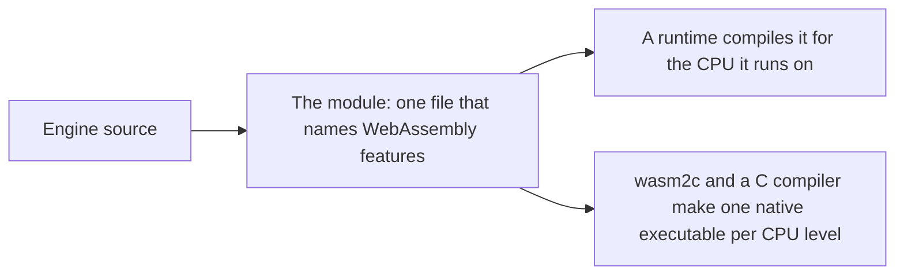

# The limits of a WebAssembly engine

The Ratchet chess engine's target is the browser, so each engine it ships is one WebAssembly file. That choice limits what
an engine can be. This document lists the limits in one place.

- **An engine written for the target** is designed inside the limits.
- **An adapted engine** is another engine built as a module. It loses what its native build used and a
  module cannot have.

In return, one file runs on every OS and CPU. Its node signature is equal under every runtime, and a browser benchmark harness can verify that each browser matches.

Two other documents own the rules, and this document points at them:

- `docs/uci-over-wasi.md` states what a module must do. This document uses its terms: module, host, GUI.
- `helper/README.md` is the how-to for an adapted engine, with each edit it needs.

This document states directions only. Ratchet's browser and runtime measurements are published in [ratchet-hce](https://github.com/ratchet-chess/ratchet-hce) (`results/browser.md`, `results/runtimes.md`).

## Where a processor matters

- **The module names WebAssembly features, not CPU features.** A runtime that lacks one of them refuses the
  whole module.
- **Every host has WebAssembly 2.0, fixed-width SIMD among it** (`docs/uci-over-wasi.md` § Form). So a module
  with SIMD needs no second file without it.
- **A runtime can lack SIMD on an old CPU.** JavaScriptCore, in Safari and Bun, turns off WebAssembly SIMD on an
  x86-64 CPU without AVX. A module with SIMD does not run there.
- **A module declares each feature beyond that** (`docs/uci-over-wasi.md` § The declaration). A host without
  one refuses the module and says why. An engine ships one module, never a second file per feature level.
- **The runtime chooses the CPU's instructions when it compiles the module.** One file serves x86 and ARM, so
  no module is built per processor.
- **A native executable fixes its CPU level when it is compiled.** `NATIVE` in `ratchet-hce`'s packager (`tools/package.ts` in [ratchet-hce](https://github.com/ratchet-chess/ratchet-hce)) lists
  them. They are the only builds per processor.

## CPU features and their WebAssembly forms

| a native engine uses | a module has | consequence |
|---|---|---|
| 64-bit integers | 64-bit integers | Bitboards need no change. |
| POPCNT, TZCNT, LZCNT | `popcnt`, `ctz` and `clz`, in WebAssembly's first version | Every runtime has them. |
| BMI2 PEXT and PDEP | nothing | Sliding attacks use magic multiplication (Ratchet's `core/magics.ts`). |
| prefetch | nothing | A search cannot prefetch a hash table entry. |
| large pages, NUMA | nothing | A module has one linear memory. |
| SSE2 to SSE4.1, NEON | fixed-width SIMD: 128-bit vectors, which every host has | One vector path serves x86 and ARM. |
| AVX2, AVX-512 | no wider vector | A 256-bit loop runs as two 128-bit steps. |
| AVX-512 VNNI | relaxed SIMD's dot products, only in their exact form | See the note below. |
| threads | wasi-threads, with a shared memory | A module searches on several threads where its host starts them (`docs/uci-over-wasi.md` § Threads). |

**A module uses relaxed SIMD only where the result is fixed** (`docs/uci-over-wasi.md` § Form). For some
inputs, a relaxed operation gives a result that the runtime chooses, and a module could then search different
nodes on different CPUs. The 8-bit dot product is exact when its second operand's bytes are in [0, 127], as a
net's clamped activations are. So a net with 8-bit layers gains from it, and one with 16-bit layers does not.

**Relaxed SIMD is pending in Safari.** Safari 27.3, in beta on 2026-11-20, adds it; no released Safari has it. A
module that declares `requires=relaxed-simd` is refused in Safari until that release. Chrome, Firefox, Node from
21 and Bun have it on.

## Limits that no edit removes

| limit | what it costs | where it is stated or measured |
|---|---|---|
| Threads only where a host starts them | On a page that is not cross-origin isolated, a module plays on one thread, and one that requires threads does not run. | `docs/uci-over-wasi.md` § Threads |
| One memory maximum for every device | A module with threads fixes its memory's maximum at the link, and some phones refuse a large one. `Hash` fits inside it. | `docs/uci-over-wasi.md` § Threads |
| 128-bit vectors | A net runs narrower than its AVX2 or AVX-512 build. | § CPU features, above |
| No PEXT, prefetch or large pages | The engine takes the path it has for a CPU without them. | § CPU features, above |
| A 32-bit address space | Memory is at most 4 GiB, and a browser can give less. `Hash` has a maximum. | `docs/uci-over-wasi.md` § UCI options; `ratchet-hce` `results/browser.md` |
| Memory never shrinks | A freed hash table still counts against the limit. | `helper/README.md` § Building |
| A runtime compiles the code | The search is slower than a C compiler's build of the same code. The first searches are slower still. | `ratchet-hce` `results/browser.md`, `results/runtimes.md` |
| No file | Probing of tablebases is off, and an engine's own book is off. | `docs/uci-over-wasi.md` § What a module may rely on |
| The download | A page downloads the module, with any net inside it. | |
| The host gives the clock | A browser's clock moves in coarse steps. | `ratchet-hce` `results/browser.md` |
| Input arrives only when the module polls | What reaches a running search depends on the page. | `docs/uci-over-wasi.md` § Delivering input during a search, § In a browser |
| Another compiler and standard library | Play that depends on the standard library differs from the native build's. | `helper/README.md` § Checking an adapted engine |

A native executable removes one of these limits, outside a browser. A C compiler compiles the module's code
there, so it searches faster than under a runtime. It keeps every other limit, because it is the same
module. Ratchet makes one only from its own modules (`docs/uci-over-wasi.md` § As a native executable).

**Memory64 would lift the 4 GiB limit, and a module does not use it.** Memory64 gives a module 64-bit
addresses. Chrome from 133, Firefox from 134 and Node from 24 have it on. Safari 27.3, in beta on 2026-11-20, adds it; no
released Safari has it. A module stays 32-bit (`docs/uci-over-wasi.md` § Form). Memory64 also costs speed. A
runtime removes most bounds checks on a 32-bit memory with guard pages. On a 64-bit memory it checks each
access, so the same code runs slower (SpiderMonkey's blog, "Is Memory64 actually worth using?", 2025-01-15).
A hash table above 4 GiB is the one gain, and a browser rarely gives a page that much.

## Limits that an edit removes

Each row is an edit that adapts an engine. An engine written for the target starts in the right-hand form.

| a native engine has | the edit | where the how-to is |
|---|---|---|
| a search thread and an input thread | Run the search on the UCI thread, and poll through the poll helper. Or keep the threads, and require them. | `helper/README.md` § Adapting a thread engine, § Keeping threads |
| no input read during a search | Declare the deaf profile. The code stays as it is. | `helper/README.md` § A deaf engine |
| other thread starts, such as a threaded hash clear | Remove each one, or make it inline. A module with threads may keep the ones above `Threads` 1. | `helper/README.md` § Adapting a thread engine |
| a net read from a file | Compile the net into the module. | `docs/uci-over-wasi.md` § What a module may rely on |
| a net compiled in through incbin | Use C23 `#embed`, because incbin's assembler block has no WebAssembly form. | `helper/README.md` § Building |
| a net on SSE or AVX2 intrinsics only | Write a 128-bit path. Until then, the net runs on its scalar path. | `helper/README.md` § Building |
| `setjmp` and `longjmp`, or C++ exceptions | Build with the flags for WebAssembly exception handling. The module then needs that feature. | `helper/README.md` § Building |
| a `Hash` maximum above what a module can allocate | Cap the option. | `docs/uci-over-wasi.md` § UCI options |
| a deep search on the native stack | Set the module's stack size at the link. | `helper/README.md` § Building |
| code that assumes a 64-bit pointer or `size_t` | Give each such value its 64-bit type by name. | `helper/README.md` § Building |

## What the limits mean for each engine

- **An engine written for the target** loses only speed against a native engine of the same design. Its
  design already follows the limits: threads only above `Threads` 1, magic multiplication, no file.
- **An adapted engine loses every row above that its native build used.** At a fixed depth it searches its
  native build's nodes, unless its play depends on the standard library (`helper/README.md` § Checking an
  adapted engine). On a clock it is slower, and it plays its endgames without tablebases.
- **So an adapted engine's rating is not its native build's rating.**

## Where the sizes are

Published measurements for the Ratchet own engine are in [ratchet-hce](https://github.com/ratchet-chess/ratchet-hce):

- **`results/browser.md`:** speed in each browser beside Bun and Node, cold start, clock step, and memory ceilings.
- **`results/runtimes.md`:** speed across JavaScript runtimes and native `wasm2c` builds.
