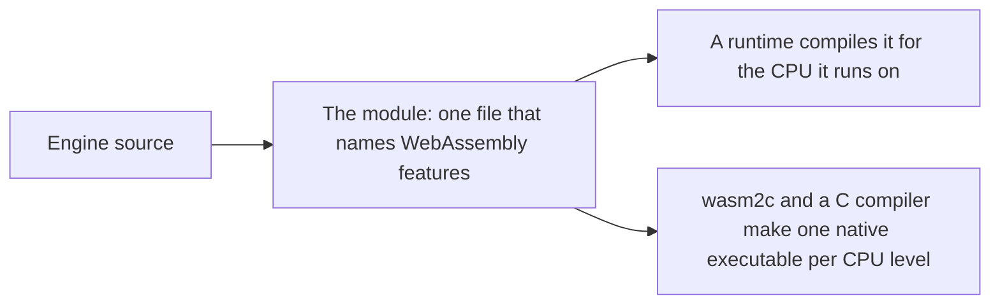

# The limits of a WebAssembly engine

Ratchet's target is the browser, so each engine it ships is one WebAssembly file. That choice limits what
an engine can be. This document lists the limits in one place.

- **An engine written for the target** is designed inside the limits.
- **A port** is another engine built as a module. It loses what its native build used and a module cannot have.

In return, one file runs on every OS and CPU. Its node signature is equal under every runtime, and
`tools/browser-bench.ts` stops if a browser's differs.

Two other documents own the rules, and this document points at them:

- `docs/uci-over-wasi.md` states what a module must do. This document uses its terms: module, host, GUI.
- `helper/README.md` is the how-to for a port, with each edit a port needs.

This document states directions only. § Where the sizes are names the measurements.

## Where a processor matters

- **The module names WebAssembly features, not CPU features.** A runtime that lacks one of them refuses the
  whole module.
- **So a feature level is a separate file.** A host that offers two levels checks the runtime first, with
  `WebAssembly.validate`. `FEATURES` in `web/bench.ts` has such checks.
- **The runtime chooses the CPU's instructions when it compiles the module.** One file serves x86 and ARM, so
  no module is built per processor.
- **A native executable fixes its CPU level when it is compiled.** `NATIVE` in `tools/package.ts` lists
  them. They are the only builds per processor.
- **A Bun executable contains Bun's own runtime,** which Bun builds per OS and CPU level. `--bun` in
  `tools/package.ts` names the target.

## CPU features and their WebAssembly forms

| a native engine uses | a module has | consequence |
|---|---|---|
| 64-bit integers | 64-bit integers | Bitboards need no change. |
| POPCNT, TZCNT, LZCNT | `popcnt`, `ctz` and `clz`, in WebAssembly's first version | Every runtime has them. |
| BMI2 PEXT and PDEP | nothing | Sliding attacks use magic multiplication (`core/magics.ts`). |
| prefetch | nothing | A search cannot prefetch a hash table entry. |
| large pages, NUMA | nothing | A module has one linear memory. |
| SSE2 to SSE4.1, NEON | fixed-width SIMD: 128-bit vectors, a feature beyond the first version | One vector path serves x86 and ARM. |
| AVX2, AVX-512 | no wider vector | A 256-bit loop runs as two 128-bit steps. |
| AVX-512 VNNI | relaxed SIMD, a further feature, has dot products | See the note below. |
| threads | the threads feature, with shared memory | A module has one thread (`docs/uci-over-wasi.md` § Form). |

**Relaxed SIMD can differ by CPU.** For some inputs, a relaxed operation gives a result that the runtime
chooses. A module that uses one can then search different nodes on different CPUs. Ratchet's builds use none:
`tools/build.sh` passes no `--enable`, so its modules have no SIMD.

## Limits that no edit removes

| limit | what it costs | where it is stated or measured |
|---|---|---|
| One thread | An engine with a parallel search plays on one thread. | `docs/uci-over-wasi.md` § Form |
| 128-bit vectors | A net runs narrower than its AVX2 or AVX-512 build. | § CPU features, above |
| No PEXT, prefetch or large pages | The engine takes the path it has for a CPU without them. | § CPU features, above |
| A 32-bit address space | Memory is at most 4 GiB, and a browser can give less. `Hash` has a maximum. | `docs/uci-over-wasi.md` § UCI options; `results/browser.md`, largest memory |
| Memory never shrinks | A freed hash table still counts against the limit. | `helper/README.md` § Building |
| A runtime compiles the code | The search is slower than a C compiler's build of the same code. The first searches are slower still. | `results/browser.md`, the cold columns; `results/runtimes.md` |
| No file | Probing of tablebases is off, and an engine's own book is off. | `docs/uci-over-wasi.md` § What a module may rely on |
| The download | A page downloads the module, with any net inside it. | |
| The host gives the clock | A browser's clock moves in coarse steps. | `results/browser.md`, clock step |
| Input arrives only when the module polls | What reaches a running search depends on the page. | `docs/uci-over-wasi.md` § Delivering input during a search, § In a browser |
| Another compiler and standard library | Play that depends on the standard library differs from the native build's. | `helper/README.md` § Checking a port |

A native executable removes one of these limits, outside a browser. A C compiler compiles the module's code
there, so it searches faster than under a runtime. It keeps every other limit, because it is the same
module. Ratchet makes one only from its own modules (`docs/uci-over-wasi.md` § As a native executable).

## Limits that an edit removes

Each row is an edit to a port. An engine written for the target starts in the right-hand form.

| a native engine has | the edit | where the how-to is |
|---|---|---|
| a search thread and an input thread | Run the search on the UCI thread, and poll through the poll helper. | `helper/README.md` § Porting a thread engine |
| no input read during a search | Declare the deaf profile. The code stays as it is. | `helper/README.md` § A deaf engine |
| other thread starts, such as a threaded hash clear | Remove each one, or make it inline. | `helper/README.md` § Porting a thread engine |
| a net read from a file | Compile the net into the module. | `docs/uci-over-wasi.md` § What a module may rely on |
| a net compiled in through incbin | Use C23 `#embed`, because incbin's assembler block has no WebAssembly form. | |
| a net on SSE or AVX2 intrinsics only | Write a 128-bit path. Until then, the net runs on its scalar path. | |
| `setjmp` and `longjmp`, or C++ exceptions | Build with the flags for WebAssembly exception handling. The module then needs that feature. | `helper/README.md` § Building |
| a `Hash` maximum above what a module can allocate | Cap the option. | `docs/uci-over-wasi.md` § UCI options |
| a deep search on the native stack | Set the module's stack size at the link. | `helper/README.md` § Building |
| code that assumes a 64-bit pointer or `size_t` | Give each such value its 64-bit type by name. | |

Two forms need no edit:

- **Rust's `include_bytes!`** compiles a file into the module as written.
- **Portable vector source,** such as Rust's `std::simd`, compiles to 128-bit steps as written.

## What the limits mean for each engine

- **An engine written for the target** loses only speed against a native engine of the same design. Its
  design already follows the limits: one thread, magic multiplication, no file.
- **A port loses every row above that its native build used.** At a fixed depth it searches its native
  build's nodes, unless its play depends on the standard library (`helper/README.md` § Checking a port).
  On a clock it is slower, and it plays its endgames without tablebases.
- **So a port's rating is not its native build's rating.**

## Where the sizes are

- **`results/browser.md`:** an engine's speed in each browser beside Bun and Node, its cold start, and what
  each browser offers.
- **`results/runtimes.md`:** each engine's speed under each runtime.
